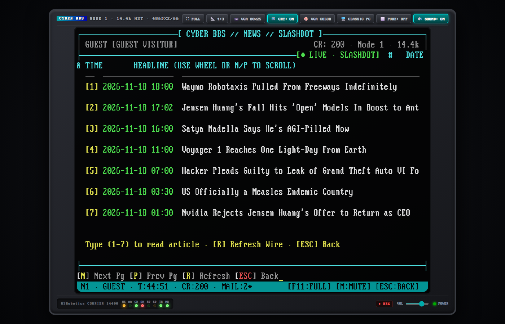
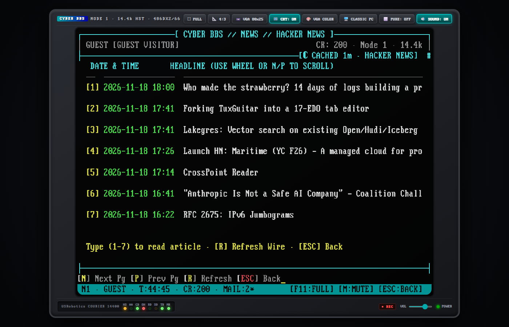
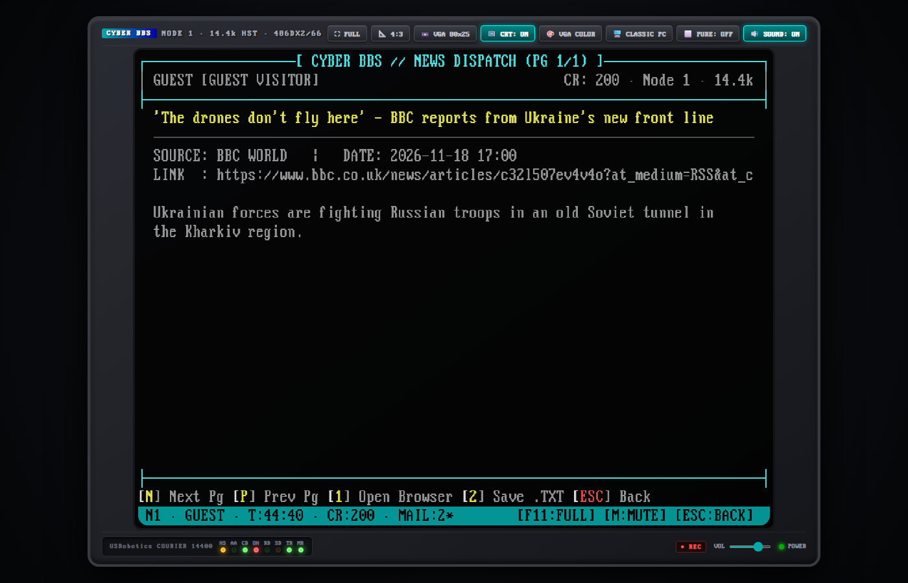
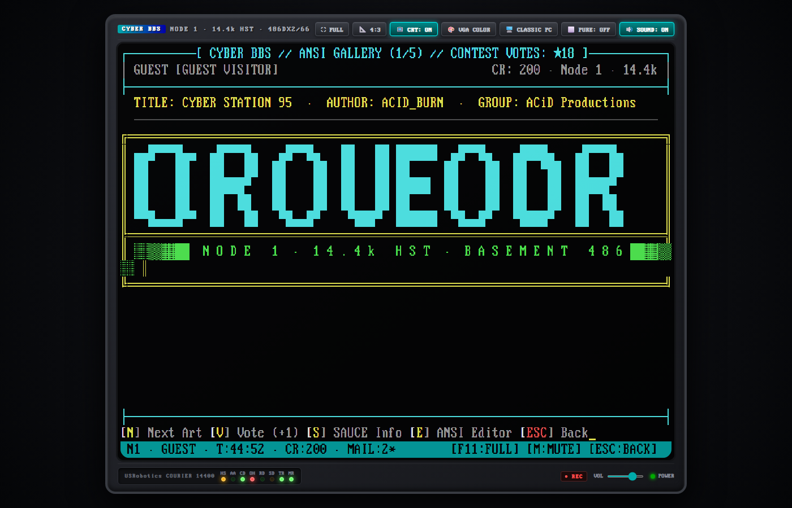

<div align="center">

# CYBER BBS

### Mega Edition v4.0 · The Ultimate 1990s Dial-Up Terminal Experience for the Modern Web

**CYBER BBS** is a self-contained, browser-based ANSI/CP437 bulletin board workstation. It combines authentic 1990s dial-up telecommunications atmosphere with real-world live data utility: real-time financial quotes and sparklines, global satellite weather with moon phase tracking, seismic radars, International Space Station tracking, live streaming web radio with real-time ASCII VU meters, Wikipedia encyclopedia terminal reader, public domain classic literature with `FILE_ID.DIZ` downloads, carrier line diagnostics, 10 historic hardware video profiles (MDA, CGA, EGA, VGA, SVGA, OLED), Hayes AT modem acoustic dialing, 7 door games, local netmail, forums, and an ANSI art studio.

It runs standalone directly from a single HTML file without node/backend servers, databases, or API keys.

<p>
  <a href="https://github.com/marceloasl99/cyber-bbs"></a>
  <a href="https://github.com/marceloasl99/cyber-bbs"></a>
  <a href="https://github.com/marceloasl99/cyber-bbs/commits/main"></a>
  
  
  
  
</p>

<p>
  <code>retro-computing</code>
  <code>bulletin-board-system</code>
  <code>ansi-art</code>
  <code>cp437</code>
  <code>hayes-modem</code>
  <code>web-audio</code>
  <code>ascii-radar</code>
  <code>offline-first</code>
  <code>single-file</code>
</p>

<p>
  <a href="index.html"><strong>🚀 Launch CYBER BBS</strong></a> ·
  <a href="#quick-start">Quick start</a> ·
  <a href="#video-hardware-adapters">Video Adapters</a> ·
  <a href="#full-door-directory">All 22 Doors</a> ·
  <a href="#terminal-commands--controls">Commands & Controls</a> ·
  <a href="#screenshots">Screenshots</a>
</p>

</div>

<p align="center">
  
  
</p>

---

## 💾 Why CYBER BBS?

CYBER BBS bridges the visceral sensory atmosphere of mid-90s PC computing with everyday modern digital utility. Rather than a purely cosmetic retro mockup, CYBER BBS provides real-time information streams, robust offline fallbacks, functional tools, and rich interactive games.

The system is operated in fiction by **DR. NOISE** on a basement **486DX2/66** PC with a **USRobotics Courier 14.4k HST Dual Standard** modem on COM2. Everything in the interface is keyboard-first, mouse-interactive, responsive, and render-accelerated through custom HTML5 canvas sprite caching.

---

## 📼 Video Hardware Adapters (Multi-Profile Engine)

CYBER BBS features a dynamic hardware profile manager that recreates authentic vintage display adapters down to their native cell dimensions, character aspect ratios, and color palettes. Press **`Alt+V`** or type **`MODE`** to switch between 10 historical profiles with real-time CRT degauss coil discharge:

| ID | Adapter Profile | Period | Grid | Cell | Palette | Display Characteristics |
|:---|:---|:---:|:---:|:---:|:---:|:---|
| `vga80x25` | **IBM VGA Standard** | 1987 | 80×25 | 18×32 | 16-color VGA | Canonical 1440×800 buffer, crisp IBM 9×16 ROM font, 4:3 CRT curve |
| `mda80x25` | **IBM MDA Monochrome** | 1981 | 80×25 | 18×32 | P1 Phosphor Green | Ultra-sharp text clarity, fine horizontal scanlines, high-contrast reading |
| `cga40x25` | **IBM CGA Big Type** | 1981 | 40×25 | 36×32 | 16 RGBI | Bold large characters, chunky 8×8 glyphs, arcade nostalgia vibe |
| `cga80x25` | **IBM CGA PC XT Text** | 1981 | 80×25 | 18×32 | 16 RGBI | Original 1981 IBM PC 5150 text experience with coarse scanlines |
| `cga_comp` | **CGA Composite NTSC** | 1981 | 80×25 | 18×32 | 16 NTSC Artifact | Color artifacting emulation mimicking home television sets |
| `ega80x43` | **IBM EGA High Density**| 1984 | 80×43 | 18×18 | 16/64-color EGA | 43 compact lines for file directories and message threads |
| `vga80x50` | **IBM VGA 50-Line** | 1987 | 80×50 | 18×16 | 16-color VGA | High-density terminal mode with 50 compact lines |
| `vga_13h` | **VGA Mode 13h Canvas**| 1987 | 40×25 | 36×32 | 256-color palette | Retro gaming canvas mode with chunky pixels and saturated tones |
| `svga132x37`| **VESA SVGA 16:9** | 1991 | 132×37 | 11×21 | 16-color SVGA | High-resolution widescreen 16:9 aspect ratio for data monitoring |
| `modern_hd`| **Modern OLED Clean** | 2026 | 120×36 | 12×22 | Truecolor Hex | Pure bezel-free zero-scanline flat digital terminal presentation |

> **Interactive Degauss Coil:** Pressing degauss (or typing `DEGAUSS`) triggers a resonant acoustic electromagnetic hum with relay snap (`playDegauss()`) and a momentary chromatic aberration screen shake.

---

## 🗂 Full Door Directory (All 22 Areas)

CYBER BBS Mega Edition v4.0 organizes its functionality across 22 functional doors and systemic utilities:

### 📡 Live Telemetry & Information
- **`[ 1]` News & Live Feeds (`NEWS`):** Live RSS feeds from Hacker News, BBC World, Slashdot, NASA Releases, and Ars Technica with `DataStatus` transparency badges (`[● LIVE]`, `[◐ CACHED]`, `[○ STALE]`).
- **`[10]` Weather Station 2.0 (`WEATHER`):** Meteorological telemetry via Open-Meteo with 24-hour hourly temperature trends, 5-day daily forecasts, precipitation probability, and offline astronomical **Moon Phase calculation** (age, illumination %, glyph).
- **`[13]` Today Hub Briefing (`TODAY`):** Consolidated daily briefing combining local weather, top global headlines, active SysOp bulletins, contest leaders, and quick-launch doors.
- **`[15]` Weekly BBS Newspaper (`NEWSPAPER`):** Automated weekly digest with SysOp editorials, top voted artpacks, trivia champions, and exportable `.TXT` newspaper issues.
- **`[18]` Market Wire & Forex (`MARKET`):** Real-time currency exchange rates (USD, EUR, BRL, GBP, JPY, CAD) and cryptocurrencies (BTC, ETH) via European Central Bank (Frankfurter) and AwesomeAPI, rendered with CP437 sparklines (` ▂▃▄▅▆▇█`) and built-in interactive currency converter (`CONV 100 USD BRL`).
- **`[19]` Earth & Sky Telemetry (`EARTH`):** Real-time USGS global earthquake network monitoring (M3.5+) and International Space Station (ISS) orbital position plotted directly onto a live 74×9 ASCII world map.
- **`[20]` Cyber Radio & ASCII VU Tuner (`RADIO`):** Internet radio streaming directory (Synthwave, Chiptune, Ambient, 80s) with background HTML5 audio playback and an animated 8-band real-time **ASCII VU Meter** (` ▂▃▄▅▆▇█`) driven by Web Audio FFT frequency data.
- **`[21]` Wiki & Gutenberg Books (`WIKI` / `BOOKS`):** Live Wikipedia article search and reader in clean DOS formatting, alongside curated Project Gutenberg public domain classics (Frankenstein, The Time Machine, Alice in Wonderland, The Art of War) with text reader and downloads including authentic 45-column `FILE_ID.DIZ` descriptions.
- **`[22]` Carrier & Net Diagnostics (`DIAG`):** Caller ID inspection (remote IP, ISP, ASN, calling exchange) and live HTTP ping latency matrix measuring round-trips to Cloudflare, Wikimedia, and Open-Meteo.

### 💬 Community & Communication
- **`[ 2]` Bulletin Board & Forum (`FORUM`):** Categorized message boards with threading, reply composition in terminal, view counters, and credit rewards.
- **`[ 3]` Netmail & Private Messages (`MAIL`):** Private mailboxes with multi-line message editor, unread message alerts, and automated SysOp bot responses.
- **`[11]` Live SysOp Chat (`CHAT`):** Split-screen interactive chat simulator with DR. NOISE, reacting contextually to system topics, hardware, modems, and late-night queries.
- **`[12]` One-Liners Graffiti Wall (`ONELINERS`):** Short graffiti message wall preserved in browser local storage.
- **`[14]` Multi-Node Hopper (`NODES` / `Alt+N`):** Hop between 4 fictional node lines (14.4k HST, 28.8k V.34, 14.4k Optima, 9600 Supra) with distinct active callers and modem telemetry.
- **`[ D]` BBS Phone Book (`PHONE` / `Alt+D`):** Speed dial directory with 5 unique remote nodes, playing acoustic DTMF dual-tone dialing before automatically negotiating and switching video profiles.

### 🎮 Gaming & Entertainment
- **`[ 7]` Door Games Suite (`GAMES`):** 7 playable retro games:
  - **Cyber Lord RPG:** Turn-based tavern brawls, dungeon crawls, monster fights, weapons shop, and dragon hunts.
  - **Star Trade Radar:** Interstellar galactic trading, commodities arbitrage, hyperspace jumps, and pirate encounters.
  - **Zork Bunker:** Text parser adventure exploring underground computing facilities.
  - **Trivia Night:** High-score trivia competition with historical computing questions.
  - **Blackjack 21:** Classic casino card game against the dealer.
  - **Hangman:** Classic word-guessing game with ASCII gallows.
  - **Fortune Cookie:** UNIX-style fortune and wisdom quotes.

### 🎨 Files, Art & Utilities
- **`[ 4]` File Areas & Search (`FILES`):** Searchable file libraries, `FILES.BBS` index, simulated ZMODEM download theater, and local file sandbox uploads.
- **`[ 5]` Photo Grabber & ANSI Converter (`PHOTOS`):** Search Wikimedia Commons and convert images on the fly into 16-color ANSI half-block graphics.
- **`[ 6]` GitHub Vault (`GITHUB`):** Public GitHub repository browser with README reader, directory trees, and source inspection.
- **`[ 8]` ANSI Gallery & Studio (`ANSI`):** View classic demoscene CP437 screens, vote in contests, inspect SAUCE00 metadata records, export `.ANS` files, and draw custom ANSI art with mouse and keyboard.
- **`[ 9]` World Clocks (`CLOCKS`):** Multi-timezone synchronized clocks with custom city configuration.
- **`[16]` User Statistics & Dossier (`STATS`):** Profile statistics, caller rank progression, online duration, upload/download ratio, and call logs.
- **`[17]` Settings & Atmosphere (`SETTINGS`):** Phosphor theme switching (Green CRT, Amber, Paper White, Flat), bezel monitor chassis skins (Classic PC, Compaq, Amiga 1084, IBM 5151), ambient fan/HDD noise, backup export/import (Schema v3), and video mode picker.
- **`[ 0]` Logoff & Disconnect (`LOGOFF`):** Session summary calculation and carrier hangup (`ATH0`).

---

## ⌨ Terminal Commands & Controls

Type directly at the `Command/Number> _` prompt and press `Enter`:

```text
HELP        Full command and hotkey reference
TODAY       Current daily briefing and weather
NEWS        RSS headlines from technology and world feeds
WEATHER     Weather Station 2.0 with hourly trends and moon phase
MARKET      Market Wire currency rates, crypto and sparklines
EARTH       Earth and Sky satellite and seismic radar
RADIO       Cyber Radio with real-time ASCII VU meter
WIKI        Wikipedia encyclopedia search and reader
BOOKS       Project Gutenberg classic literature library
DIAG        Carrier telemetry and line noise diagnostics
PHONE       BBS Phone Book speed dialer
MODE        Switch video hardware profile (e.g. MODE CGA, MODE MDA)
DEGAUSS     Fire CRT degaussing coil
GRAB        Export screen as .ANS (SAUCE00) and .PNG
SELFTEST    Execute automated 12-point diagnostic suite
FILES       Search file areas and download shareware
FORUM       Open message boards and discussion threads
MAIL        Open private Netmail inbox
GITHUB      Browse public GitHub code repositories
GAMES       Open Door Games menu
LORD        Play Cyber Lord RPG directly
TRADE       Play Star Trade directly
ZORK        Play Zork Bunker directly
TRIVIA      Play Trivia Night directly
ANSI        Open ANSI art gallery and editor
CLOCKS      View world clocks
NODES       View multi-node activity
NEWSPAPER   Read weekly automated BBS newsletter
STATS       Inspect caller rank and account statistics
SETTINGS    Configure display themes, audio and backups
PURE        Toggle bezel-free clean terminal mode
NIGHT       Toggle after-hours 03:15 AM basement atmosphere
LOGOFF      Disconnect and terminate carrier session
```

### Advanced Navigation
- **Command Stacking:** Separate multiple commands with `;` to execute them sequentially without waiting (e.g. `18;C` or `NEWS;FORUM`).
- **Command History:** Press `ArrowUp` or `ArrowDown` at the prompt to recall the last 25 executed commands.
- **Tab Autocompletion:** Type the beginning of any command (e.g. `MAR`, `RAD`, `WIK`) and press `Tab` to autocomplete.
- **Scrollback Buffer (500 lines):** Press `PgUp` / `PgDn` or use the mouse wheel to inspect scrolled-off lines with visual line-count overlays.
- **Global Hotkeys:**
  - `Alt+V`: Video Hardware Mode picker (10 profiles)
  - `Alt+G`: Instant Screen Grabber (`.ANS` + `.PNG`)
  - `Alt+D`: Open BBS Phone Book
  - `Alt+N`: Hop to next node line
  - `Ctrl+L`: Force redraw of terminal buffer
  - `F11` / `Alt+Enter`: Toggle fullscreen mode
  - `Esc`: Back / Cancel / Exit scrollback mode

---

## 📸 Screenshots

<div align="center">
  
  
  
  
  
  
  
  
  
</div>

---

## ⚡ Quick Start

### Option 1: Open Directly in Browser (Zero Install)
Simply double-click or open [`index.html`](index.html) in Chrome, Edge, Firefox, or Safari. No web server, Node.js, npm, or database required.

### Option 2: Run via Local HTTP Server (Recommended)
Running through a local web server ensures optimal CORS behavior when querying external RSS feeds and weather APIs:

```powershell
python -m http.server 8080
```

Then navigate to [`http://localhost:8080/index.html`](http://localhost:8080/index.html).

---

## 🛡 Privacy & Local Persistence

- **Browser Storage:** User accounts, passwords, credits, ratio, forum threads, netmail, trivia scores, and game saves are persisted strictly inside the browser's `localStorage`.
- **Binary Sandbox:** File uploads and custom `.ANS` screens are managed client-side using `IndexedDB`.
- **Zero Remote Tracking:** No analytics, telemetry, cookies, or remote authentication servers are used.
- **Crypto:** Local user credentials use browser Web Crypto API (SHA-256) for local sandbox profile isolation.

---

## 🛠 Project Architecture & Development

```text
cyber-bbs/
├── index.html                 # Canonical production single-file bundle (~431 KB)
├── cyber-bbs.html             # Synchronized standalone distribution copy
├── index-modular.html         # Modular developmental entry point
├── README.md                  # Comprehensive documentation and manual
├── LICENSE-THIRD-PARTY.md     # Font and asset license attributions
├── assets/
│   ├── css/                   # CRT shaders, scanlines and bezel chassis styles
│   ├── fonts/                 # Px437 IBM VGA 8x16 and 9x16 bitmap fonts
│   └── js/                    # Modular application architecture:
│       ├── audio.js           # Web Audio synthesizer, DTMF tones, degauss, Cyber Radio
│       ├── store.js           # Local persistence, schema v3, ranks, file catalog
│       ├── net.js             # Resilient networking layer with DataStatus envelopes
│       ├── ansi.js            # SAUCE00 parser, image-to-ANSI and buffer-to-ANSI converter
│       ├── term.js            # CP437 canvas renderer, glyph cache, 10 video profiles
│       ├── games.js           # Door Games engine (Cyber Lord, Star Trade, Zork, etc.)
│       ├── doors.js           # 22 functional system doors and user interfaces
│       └── app.js             # Master controller, command router and keyboard dispatcher
├── docs/screenshots/          # 16 automated Playwright test captures
└── tools/
    ├── bundle.mjs             # Compiles modular assets/ into canonical single-file
    ├── capture_screenshots.py # Playwright automated visual regression test runner
    └── test_diagnostics.py    # Headless in-browser diagnostic test script
```

### Rebuilding Bundles & Testing
```powershell
# 1. Compile modular scripts into standalone index.html and cyber-bbs.html
node tools/bundle.mjs

# 2. Run automated headless in-browser diagnostic verification
python tools/test_diagnostics.py

# 3. Capture automated screenshots of all 16 screens
python tools/capture_screenshots.py
```

---

## 📜 Attribution & License

- **Fonts:** Embedded `Px437_IBM_VGA9` and `Px437_IBM_VGA8` are created by VileR from the *Oldschool PC Font Pack*, licensed under CC BY-SA 4.0. See [`LICENSE-THIRD-PARTY.md`](LICENSE-THIRD-PARTY.md).
- **APIs:** Public endpoints utilized (Open-Meteo, Frankfurter ECB, AwesomeAPI, USGS Earthquakes, WhereTheISS, Radio Browser, Wikipedia REST) are free, keyless, and subject to their respective terms.
- **CYBER BBS Core Code:** MIT License. Crafted for enthusiasts of vintage computing and the golden age of telecommunications.
