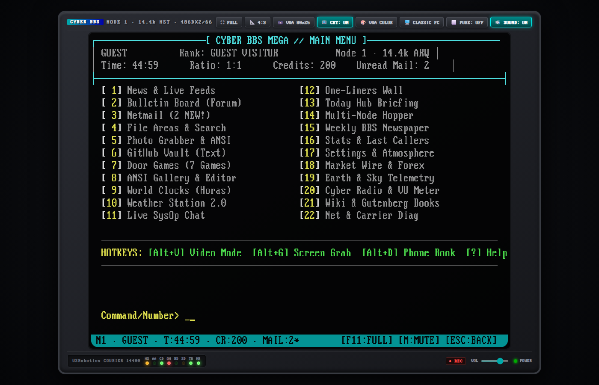
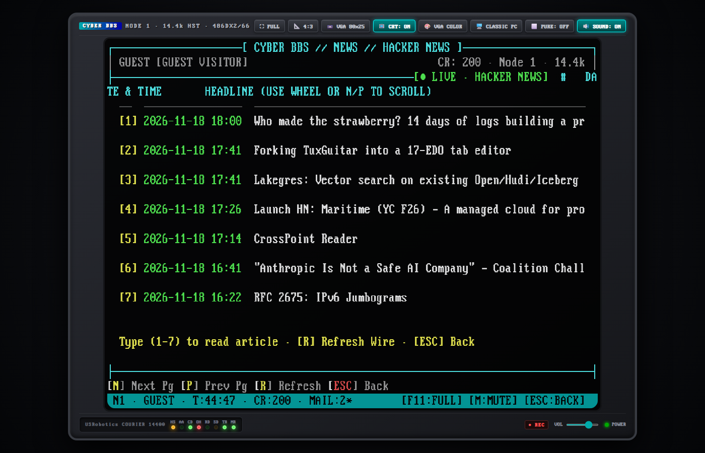
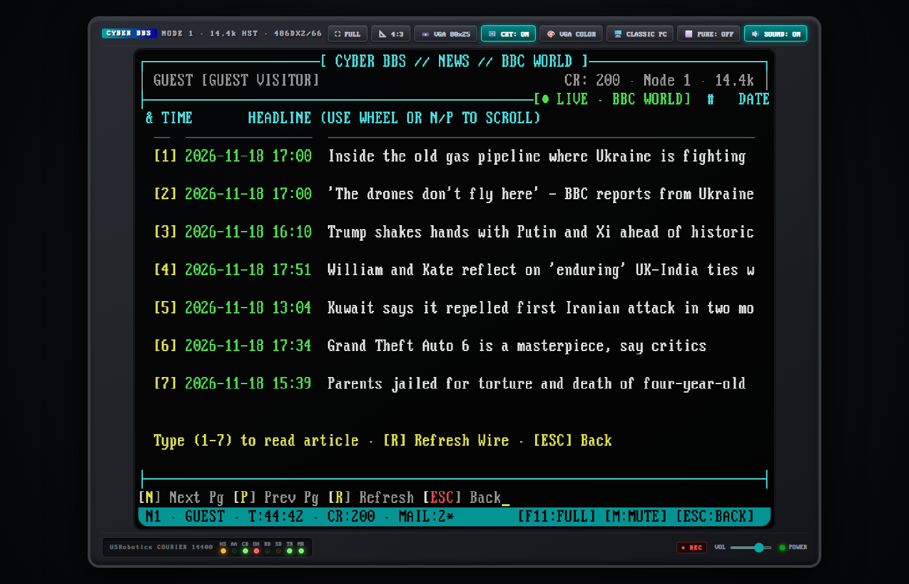
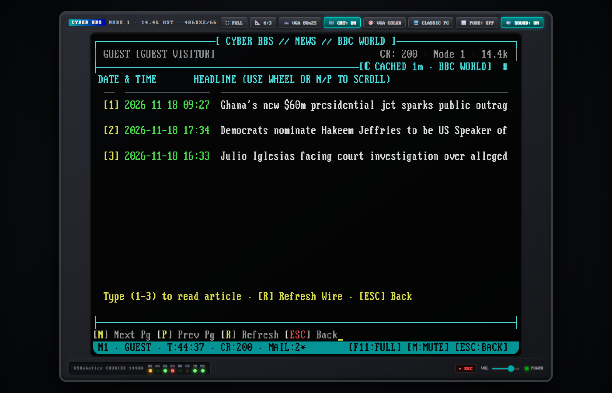
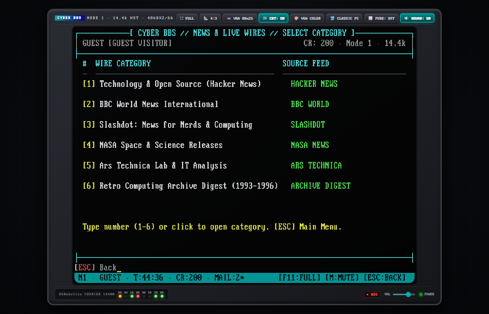

<div align="center">

# CYBER BBS

### Mega Edition v3.0 · A useful 1990s dial-up experience for today's web

**CYBER BBS** is a browser-based ANSI/CP437 bulletin board simulator with live news, current weather, GitHub browsing, local netmail, file areas, games, an ANSI editor, multi-node activity, and a daily briefing. It boots directly from one HTML file and works without a backend.

<p>
  <a href="https://github.com/marceloasl99/cyber-bbs"></a>
  <a href="https://github.com/marceloasl99/cyber-bbs/commits/main"></a>
  
  
  
</p>

<p>
  <code>retro</code>
  <code>bbs</code>
  <code>ansi</code>
  <code>cp437</code>
  <code>rss</code>
  <code>weather</code>
  <code>github-api</code>
  <code>web-audio</code>
  <code>offline-first</code>
  <code>single-file</code>
</p>

<p>
  <a href="index.html">Launch CYBER BBS</a> ·
  <a href="#quick-start">Quick start</a> ·
  <a href="#screenshots">Screenshots</a> ·
  <a href="#features">Features</a>
</p>

</div>

<p align="center">
  
  
</p>

## Why this project?

CYBER BBS preserves the atmosphere of a fictional 1995 BBS while making the experience practical today. Instead of a static mockup, it provides current RSS headlines, live weather with fallback sources, useful links, local productivity features, and replayable doors.

The fiction is operated by **DR. NOISE** on a 486DX2/66 with a USRobotics Courier 14.4k HST modem. The interface is English, keyboard-friendly, and designed around an 80×25 terminal.

## Features

### Current information

- **Today Hub:** current date/time, weather, RSS headlines, source health, and practical links.
- **News & Live Feeds:** Hacker News, BBC World, Slashdot, NASA News, and Ars Technica.
- **Weather Telemetry:** `wttr.in` first, Open-Meteo fallback, and a clearly labeled offline sensor.
- **GitHub Vault:** public repository search, README reading, directory browsing, and archive links.
- **Photo Grabber:** Wikimedia Commons search and 16-color ANSI half-block conversion.
- **Weekly Newspaper:** generated local BBS newspaper with system activity, headlines, weather, and editorials.

### BBS experience

- **Netmail:** local inbox, replies, deletion, unread counters, multiline composition, and SysOp bot replies.
- **Forums and One-Liners:** local posts stored in the browser.
- **File Areas:** searchable `FILES.BBS` catalog, `FILE_ID.DIZ`, browser downloads, ZMODEM theater, and local uploads.
- **ANSI Workshop:** gallery voting, SAUCE metadata, and a mouse/keyboard ANSI editor.
- **Multi-Node Hopper:** switch between fictional node lines with separate callers and activity.
- **Door Games:** Cyber Lord RPG, Star Trade, Zork-style adventure, Trivia Night, Blackjack, Hangman, Fortune, and more.
- **Progression:** ranks, credits, login streaks, upload/download ratio, trivia score, and ANSI Master status.

### Browser quality

- Keyboard, mouse, and terminal hit-region navigation.
- Focus states, reduced-motion support, screen-reader metadata, and accessible labels.
- Web Audio modem and terminal effects, activated only after user interaction.
- Fullscreen synchronization, redraw support, and reliable back navigation.
- Local-first fallbacks when external providers fail.

## Quick start

### Open directly

Open [`index.html`](index.html) in Chrome, Edge, or Firefox. No installation, npm, database, Docker, or API key is required.

### Run through a local HTTP server

HTTP mode is recommended for the most reliable behavior with RSS and weather providers:

```powershell
python -m http.server 8080
```

Then visit [`http://localhost:8080/index.html`](http://localhost:8080/index.html).

`cyber-bbs.html` is a synchronized standalone distribution copy.

## First session

1. Open `index.html`.
2. Press `1`, `Enter`, or click the dial area.
3. Press `Esc` to skip the synthesized modem handshake.
4. Choose guest login or create a local profile.
5. Press `1` for the main menu.
6. Try `13` or type `TODAY` to open the current briefing.

Use the sound button or the `M` command to mute audio.

## Main menu

| Key | Door |
|---:|---|
| `1` / `N` | News & Live Feeds |
| `2` / `B` | Bulletin Board and Forum |
| `3` / `E` | Netmail / Private Mail |
| `4` / `F` | File Areas and Search |
| `5` / `P` | Photo Grabber and ANSI conversion |
| `6` / `G` | GitHub Vault |
| `7` / `D` | Door Games (7 Games) |
| `8` / `A` | ANSI Gallery and Editor |
| `9` / `H` | World Clocks |
| `10` / `W` | Weather Station 2.0 (Hourly, 5-Day & Moon Phases) |
| `11` / `C` | Live SysOp Chat |
| `12` / `O` | One-Liners Wall |
| `13` / `T` | Today Hub Briefing |
| `14` / `M` | Multi-Node Hopper |
| `15` / `J` | Weekly BBS Newspaper |
| `16` / `U` | User Statistics and Last Callers |
| `17` / `S` | Settings and Atmosphere |
| `18` | Market Wire & Forex (Currencies, Crypto & Ticker) |
| `19` | Earth & Sky Telemetry (ISS Radar & USGS Quakes) |
| `20` | Cyber Radio & Real-Time ASCII VU Meter |
| `21` | Wiki Terminal & Gutenberg Classic Literature |
| `22` | Carrier Telemetry & Net Diagnostics |
| `0` / `X` / `Q` | Logoff and Disconnect |

## Terminal commands and controls

Type commands at the terminal prompt:

```text
HELP       Full command reference
TODAY      Current daily briefing
NEWS       RSS headlines
WEATHER    Current weather station 2.0
FILES      Search file areas
MAIL       Open Netmail
GITHUB     Open GitHub Vault
MARKET     Market Wire & live forex
EARTH      Earth & Sky satellite radar
RADIO      Cyber Radio with live ASCII VU meter
WIKI       Wikipedia terminal search
BOOKS      Project Gutenberg classic literature
DIAG       Carrier & line noise diagnostics
PHONE      Dial-up phone book directory
MODE       Cycle or select video hardware adapter
DEGAUSS    Fire CRT degaussing coil
GRAB       Export screen as .ANS (SAUCE00) and .PNG
SELFTEST   Execute automated 12-point diagnostic suite
NODES      Multi-node status
NEWSPAPER  Weekly BBS newspaper
STATS      User statistics
SETTINGS   Preferences and export/restore
PURE       Toggle clean text-only mode
NIGHT      Toggle after-hours atmosphere
LOGOFF     Disconnect
```

| Control | Action |
|---|---|
| `Enter` / `Space` | Activate the selected item |
| Arrow keys / `Tab` | Move through terminal regions / Autocomplete commands |
| `ArrowUp` / `ArrowDown` | Cycle command history (last 25 commands) |
| `;` delimiter | Chain commands (e.g. `18;C` or `NEWS;FORUM`) |
| `PgUp` / `PgDn` | Scroll through 500-line scrollback buffer |
| `Esc` | Cancel, exit scrollback, or go back |
| `Alt+V` | Open Video Hardware Mode selector (10 profiles) |
| `Alt+G` | Screen Grab (.ANS with SAUCE00 + .PNG) |
| `Alt+D` | Open BBS Phone Book |
| `F11` / `Alt+Enter` | Toggle fullscreen |
| `Ctrl+L` | Redraw the current screen |
| `Alt+N` | Hop to the next fictional node |
| Mouse click | Activate highlighted rows |
| Mouse wheel | Scroll terminal scrollback or page through views |

## Screenshots

<div align="center">
  
  
  
  
  
  
  
  
  
</div>

Regenerate screenshots from the public entry point:

```powershell
python tools\capture_screenshots.py
```

## Live data and offline behavior

| Door | Primary source | Fallback |
|---|---|---|
| News | RSS/Atom feeds | Cached headlines and archive digest |
| Weather | `wttr.in` | Open-Meteo, then local sensor message |
| GitHub | Public GitHub REST API | Seed repositories |
| Images | Wikimedia Commons | Search link and cached metadata |

The interface labels data as `LIVE`, `CACHED`, or `OFFLINE`. External data is never required for booting the BBS.

## Privacy and local persistence

- `localStorage` stores profiles, preferences, forums, netmail, ranks, settings, and game saves.
- IndexedDB stores uploaded file contents and local binary data.
- Browser data is not synchronized with other users.
- Local mail and forum posts are not sent to a public server.
- Passwords use browser Web Crypto hashing, suitable for local demo profiles only.
- There is no analytics, telemetry, or remote account system.

## Project structure

```text
cyber-bbs/
├── index.html                 # Canonical standalone application
├── cyber-bbs.html             # Synchronized distribution copy
├── index-modular.html         # Preserved earlier modular entry point
├── README.md
├── LICENSE-THIRD-PARTY.md
├── assets/
│   ├── css/                   # CRT and terminal styling sources
│   ├── fonts/                 # Px437 IBM VGA fonts
│   └── js/                    # Modular application sources
├── docs/screenshots/          # Current UI captures
└── tools/
    ├── bundle.mjs             # Synchronizes index.html to cyber-bbs.html
    └── capture_screenshots.py # Playwright capture workflow
```

## Development

The canonical product is the self-contained `index.html`:

```powershell
node tools\bundle.mjs
node --check .\tools\bundle.mjs
python tools\capture_screenshots.py
git diff --check
```

The modem, ZMODEM transfer, SysOp replies, node activity, and bot responses are simulations. A backend would be required for real multi-user boards, public mail delivery, synchronized presence, and shared uploads.

## Attribution and license

The embedded Px437 IBM VGA fonts are attributed to VileR and the Oldschool PC Font Pack under CC BY-SA 4.0. See [`LICENSE-THIRD-PARTY.md`](LICENSE-THIRD-PARTY.md).

External news, images, repositories, and downloads remain subject to their original providers' terms. CYBER BBS application content follows the repository license.
