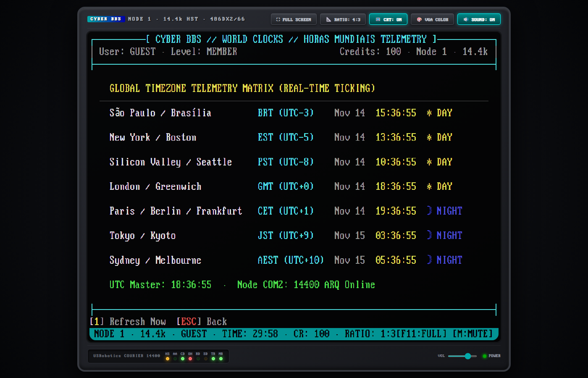
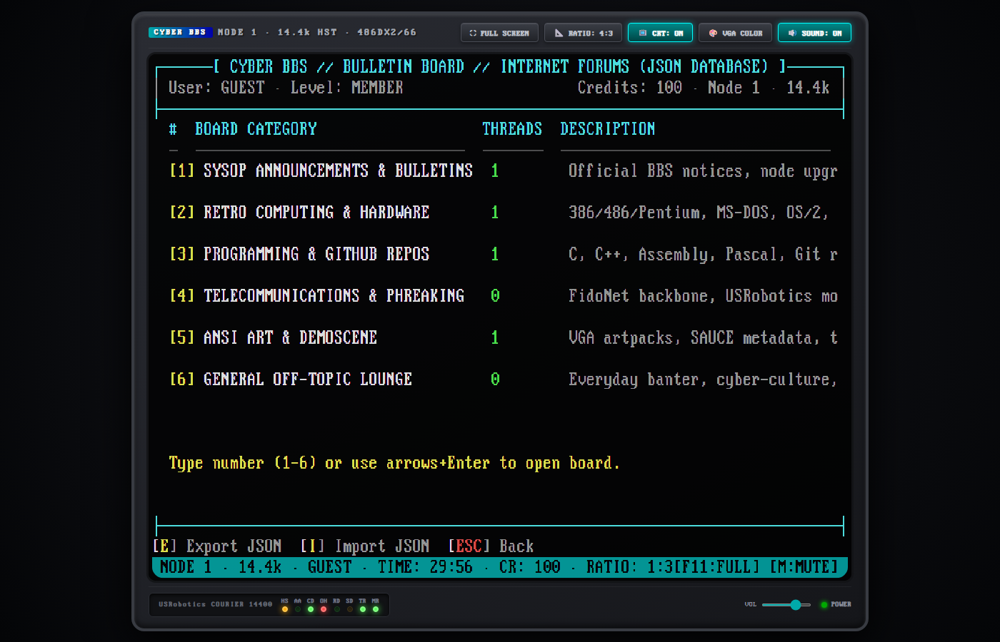
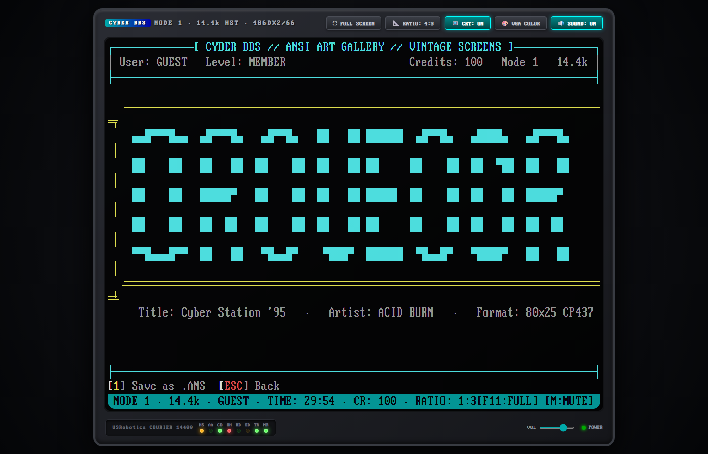
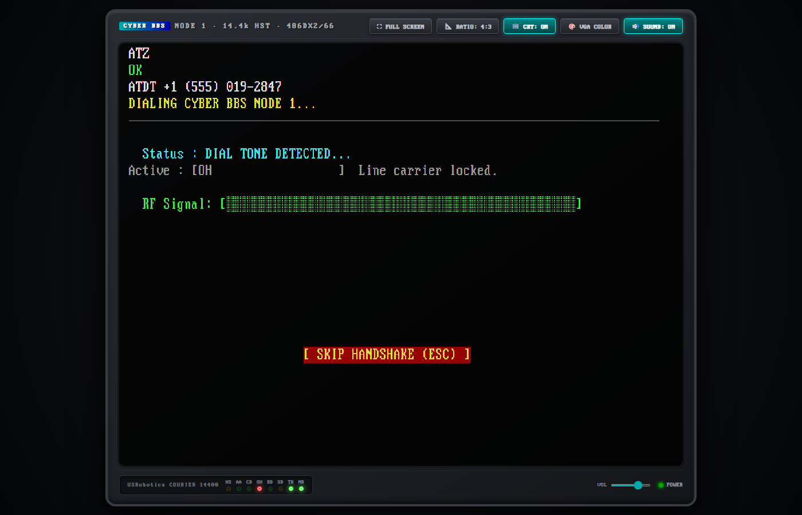
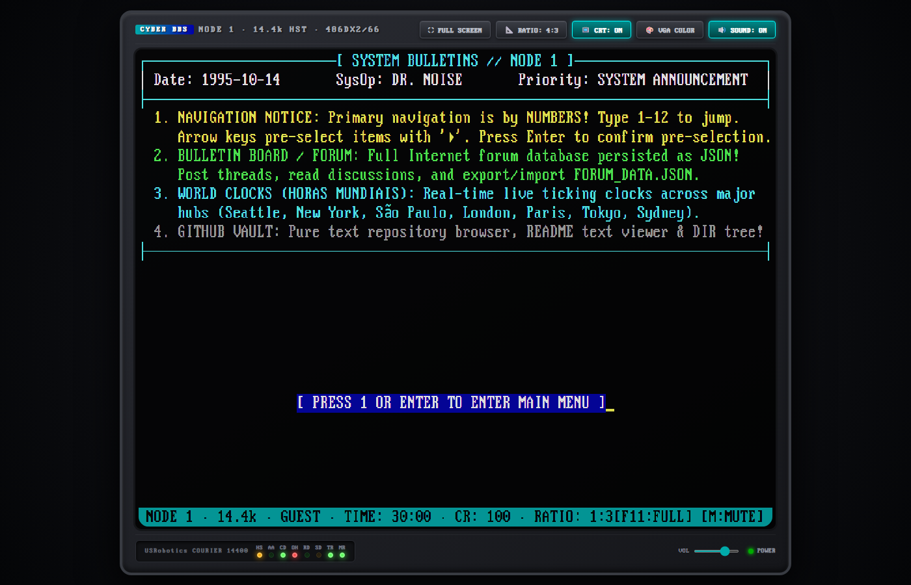

# CYBER BBS — 1990s Dial-Up Simulator

[](LICENSE-THIRD-PARTY.md)
[](cyber-bbs.html)
[](cyber-bbs.html)
[](cyber-bbs.html)

> **Tags:** `bbs`, `bulletin-board-system`, `dial-up`, `retro-computing`, `1990s`, `cp437`, `ansi-art`, `terminal-emulator`, `web-audio-api`, `usrobotics`

A high-fidelity browser-based simulation of a 1990s dial-up Bulletin Board System running on a simulated 486DX2/66 with a USRobotics 14.4k HST modem and SysOp **DR. NOISE**.

Combines authentic vintage visuals and procedural Web Audio with **real, live Internet doors** (live RSS news, file downloads with Zmodem theater, real Wikimedia image searches with an on-the-fly Image-to-ANSI converter, GitHub repository explorer, and message base with local echo bots).

---

## 📸 Screenshots

| 🖥️ Main Menu (80x25 Matrix) | 🌐 Real-Time World Clocks |
|:---:|:---:|
|  |  |

| 💬 Internet Forum / Bulletin Board | 🎨 ANSI Art Gallery |
|:---:|:---:|
|  |  |

| ☎️ USRobotics 14.4k Handshake | 📜 System Bulletins |
|:---:|:---:|
|  |  |

---

## 🚀 How to Run on Windows

You have two convenient options:

### Option 1: Instant Double-Click (Zero Setup)
Simply double-click either:
- **`cyber-bbs.html`** (Standalone single-file edition, 100% self-contained)
- Or **`index.html`** (Modular edition)

It opens directly in Google Chrome, Microsoft Edge, or Firefox.

### Option 2: Local HTTP Server (Recommended for Best Network Performance)
In PowerShell or Command Prompt inside `C:\55\bbs`:
```powershell
python -m http.server 8080
```
Then open `http://localhost:8080/` in your browser.

---

## 🖥️ Full Screen (Full HD 1080p)

Cyber BBS includes full support for 1920×1080 displays:
- **Toggle Fullscreen**: Click the **`[ ⛶ FULL SCREEN ]`** bezel button on the top panel, or press **`F11`** or **`Alt+Enter`** on your keyboard.
- **Crisp Integer Scaling**: The 80×25 terminal canvas scales sharply using nearest-neighbor pixel rendering without blurring.
- **Aspect Ratio Switching**: Click **`[ 📐 RATIO: 4:3 ]`** to toggle between Classic 4:3 CRT monitor letterboxing and 16:9 widescreen.
- **Glowing Modem LEDs**: The bottom bezel features animated status LEDs (`HS`, `AA`, `CD`, `OH`, `RD`, `SD`, `TR`, `MR`) that light up and blink in sync with modem dialing, typing, and file transfers!

---

## ⌨️ Dual Navigation (Keyboard & Mouse)

### 1. 100% Keyboard-Navigable (No Mouse Required)
- **Hotkeys**: Single-letter commands from the Main Menu:
  - `[N]` News & Feeds (Real live RSS from Hacker News, NASA, BBC, Ars Technica)
  - `[F]` File Areas & Downloads (Zmodem progress theater + local upload)
  - `[P]` Photo Grabber (Real image search + Image-to-ANSI converter)
  - `[G]` GitHub Vault (Real repository search, README viewer, ZIP downloads)
  - `[M]` Message Base (FidoNet echo conferences + 6 local echo bots)
  - `[D]` Door Games (Cyber Lord RPG, Star Trade, Blackjack, Hangman, Fortune)
  - `[A]` ANSI Art Gallery (SAUCE metadata viewer and `.ans` exporter)
  - `[W]` Weather Station (Live satellite weather via wttr.in)
  - `[C]` Live SysOp Chat (Split-screen interactive chat with Dr. Noise)
  - `[O]` One-Liners Graffiti Wall
  - `[L]` Last Callers Log
  - `[U]` User Statistics & Call History
  - `[B]` System Bulletins
  - `[S]` Settings (Color themes, CRT filters, aspect ratios)
  - `[X]` / `[Q]` Logoff & Hangup
  - `[?]` Help & Command Reference
- **Arrow Keys & Enter**:
  - `▲` / `▼` / `◄` / `►` (or `Tab` / `Shift+Tab`) moves highlighted selection across menu items and tables with audible retro mechanical clicks.
  - `Enter` or `Space` activates the highlighted option.
- **Escape**: Returns to the previous menu or aborts streaming text.
- **Command Prompt**: Type commands at `Command> _` such as `NEWS`, `FILES`, `DIR`, `PHOTOS`, `GITHUB`, `MSGS`, `GAMES`, `WEATHER`, `CHAT`, `ANSI`, `WHO`, `STATS`, `SETTINGS`, `HELP`, `LOGOFF`.

### 2. 100% Mouse-Navigable
- Every menu row, table item, action button, and bezel switch is interactive and clickable.
- Hovering over any element displays an interactive cursor and yellow selector highlight.
- Mouse scrollwheel is supported for scrolling through news dispatches and text files.

---

## 🔊 Procedural Web Audio Engine

No external audio files are downloaded; all audio is synthesized procedurally in real-time via the Web Audio API:
- Dual-tone dial tone (350Hz + 440Hz).
- DTMF touch-tone pulse pairs.
- Ringback cadence (440Hz + 480Hz).
- 14.4k USRobotics Courier handshake: V.25 answer tone (2100Hz), V.8 chirps, line probing ladder, scrambler white noise bursts, and final carrier lock chime.
- Mechanical keyboard key clicks on typing.
- Terminal bell (`BEL` 880Hz beep).
- Zmodem transfer ticks and carrier drop hangup click.
- Audio can be muted or unmuted anytime via the on-screen **`[ 🔊 SOUND ]`** button.
- Press **`ESC`** or click **`[ SKIP HANDSHAKE ]`** to jump straight to the login screen.

---

## 🎨 Color Themes & CRT Filters

Click **`[ 🎨 THEME ]`** on the bezel or visit `[S] Settings` to toggle between:
1. **VGA Color** (Classic 16-color IBM VGA palette)
2. **Green Phosphor** (P1 Matrix-style green monochrome)
3. **Amber CRT** (Warm 3105 vintage amber monochrome)
4. **Paper White** (Monochrome laboratory terminal)
5. **Flat LCD** (Clean pixels, CRT effects disabled)

Toggle **`[ 📺 CRT ]`** to enable or disable scanlines, screen curvature, and phosphor bloom.

---

## 🛠️ Project Structure

```text
cyber-bbs/
├── index.html              # Modular application entry point
├── cyber-bbs.html          # Standalone single-file bundle (zero dependencies, 250 KB)
├── plan.txt                # Original architectural blueprint & specification
├── LICENSE-THIRD-PARTY.md  # Attribution for VileR int10h IBM VGA fonts (CC BY-SA 4.0)
├── README.md               # User manual and developer guide
├── assets/
│   ├── css/
│   │   ├── fonts.css       # Embedded Base64 IBM VGA 9x16 & 8x16 typefaces
│   │   ├── terminal.css    # 80x25 grid, bezel styling, Full HD 1080p scaling, 4:3 CRT
│   │   └── crt.css         # Scanlines, vignette, curvature, color themes
│   ├── fonts/
│   │   ├── Px437_IBM_VGA_9x16.ttf
│   │   └── Px437_IBM_VGA_8x16.ttf
│   └── js/
│       ├── audio.js        # Web Audio procedural modem & terminal synth
│       ├── store.js        # Local profiles, credits, messages, IndexedDB uploads
│       ├── net.js          # Resilient fetch, proxy chain, live RSS & GitHub API
│       ├── ansi.js         # SAUCE parser & Image-to-ANSI 16-color converter
│       ├── term.js         # 80x25 virtual buffer, procedural gapless box renderer
│       ├── doors.js        # News, Files, Photos, GitHub, Forum, Games, Clocks, Chat
│       └── app.js          # Boot -> Dial -> Login -> Main Menu router & inputs
└── tools/
    └── bundle.mjs          # Standalone bundler utility
```
